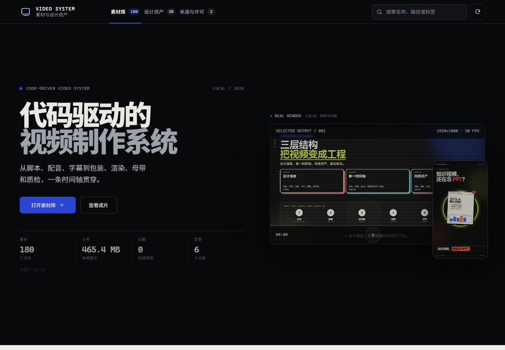
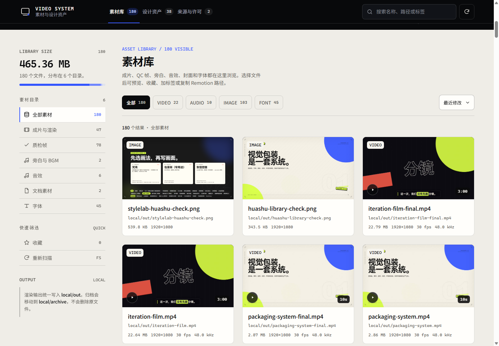
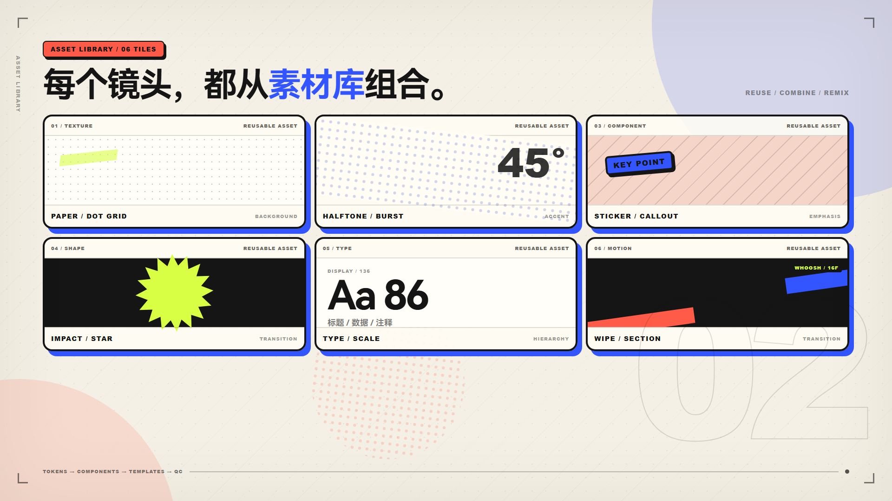

# 代码驱动的视频制作系统

一套基于 **Remotion 4、React 19、TypeScript** 的视频生产工程。它把脚本、旁白、字幕、视觉包装、素材管理、渲染、母带和质检收敛成一条可复用的工作流。

一个仓库，两层内容：

- **公共生产系统**：组件、风格包、设计资产、字体、音效和工具脚本。
- **私有视频项目**：文案、配音、时间轴、分镜和成片留在本机，不进入 Git。



> 这是一个通用视频框架仓库，不包含具体视频项目的文案、配音、分镜或成片。示例片相关源码和素材归档在本地 `local/examples/`，不会进入仓库。

## 项目定位

大多数视频制作的问题不是“不会做一条”，而是“每一条都要重新来一遍”：重新找参考、重新配色、重新搭版式、重新对字幕、重新导出、重新检查响度和峰值。

这个项目把这些重复劳动变成一套基础设施：

| 能力 | 说明 |
|---|---|
| 风格是参数 | 颜色、字号、间距、圆角、阴影和安全区都有统一 tokens。 |
| 动效是组件 | 运镜、字效、纹理、转场和场景骨架封装成可复用组件。 |
| 时间是单一真源 | 旁白、字幕、场景、BGM ducking 和音效共享同一条帧时间轴。 |
| 设计资产可检索 | 色板、风格卡、动画语法、风格包和字体在一个工作台里浏览。 |
| 质量可验证 | 渲染后自动检查编码、分辨率、帧数、响度、True Peak，并支持抽帧复核。 |
| 私有内容可隔离 | 通用组件进入仓库，具体文案、配音、时间轴和成片留在 `local/`。 |

## 项目主页

运行 `npm run assets` 打开项目主页与素材工作台：

```text
http://127.0.0.1:4321
```

主页首屏展示项目结构和一段 10 秒公共预览视频。向下滚动进入完整素材工作台。



工作台目前支持：

- 搜索素材名称、路径和标签。
- 按视频、音频、图片、字体筛选。
- 按目录、收藏、最近修改、大小、名称和时长整理。
- 预览视频、音频、图片和字体。
- 编辑标签与备注，收藏常用素材。
- 复制文件路径和 Remotion `staticFile()` 路径。
- 在系统文件管理器中定位文件。
- 归档 `local/` 下的文件到 `local/archive/`。
- 浏览设计资产、色板、风格、动画语法和来源许可。

主页视频和封面是公共静态资产，不需要本机渲染文件：

```text
studio/public/media/hero-reel.mp4   10 秒，1920×1080，H.264，无音轨，约 814 KB
studio/public/media/reel.jpg        视频封面
studio/public/media/hook.jpg        竖屏样张
```

替换主页视频时，替换 `hero-reel.mp4` 和 `reel.jpg` 即可，不需要改 HTML。主页视频放在 `studio/public/media/`，所以会跟随仓库分发；不要把主页视频放回 `local/`。

## 快速开始

要求 Node.js `^20.19` / `^22.13` / `>=24`。

```bash
npm ci

# Remotion Studio
npm run dev

# 项目主页与素材工作台
npm run assets
```

渲染和母带输出统一写入 `local/out/`。该目录已被 `.gitignore` 忽略，不会进入仓库。

如果只需要启动 Remotion Studio、不自动打开浏览器：

```bash
npm run studio
```

## 系统结构

| 层 | 作用 | 主要位置 |
|---|---|---|
| 设计语言 | 颜色、字体、间距、圆角、描边、阴影、安全区 | `src/packaging/tokens.ts`、`src/theme.ts` |
| 视觉组件 | 纸卡、贴纸、标签、章节模板、转场、纹理 | `src/packaging/` |
| 动效系统 | 入场、弹出、线条生长、运镜、词级字幕 | `src/packaging/motionPrimitives.tsx` 等 |
| 设计资产 | 9 套色板、36 张 Huashu 风格卡、9 张动画语法卡、1 个原创风格包、45 个 OFL 字体 | `src/library/`、`docs/reference/huashu/`、`public/fonts/huashu/` |
| 风格包 | 可复用组件、HUD、字幕、流程场景、预览 Composition | `src/packs/` |
| 默认旁白 | 晓晓 +15% 音色、示例音频与通用生成脚本 | `src/audio/voiceProfiles.json`、`scripts/generate-voiceover.mjs` |
| 素材工作台 | 搜索、筛选、预览、标签、备注、归档 | `studio/` |
| 后期与 QC | loudnorm 母带、编码/帧数/响度检查 | `scripts/master-video.mjs`、`scripts/verify-video.mjs` |

## 从一条新视频开始

不要在每条新视频里复制整个框架。在同一个仓库里建立私有项目：

```text
local/projects/<project-name>/
├─ lines.json
├─ timeline.generated.json
├─ timeline.generated.ts
├─ video.project.json
├─ SceneXxx.tsx
├─ Root.tsx
└─ README.md
```

推荐顺序：

1. **先看现成资产**：运行 `npm run assets`，在设计资产页确认色板、风格包、HUD、字幕条和流程场景能否直接复用。
2. **再写旁白清单**：在 `local/projects/<project-name>/lines.json` 写 `id`、`text`、`highlights` 和段落信息。
3. **生成时间轴**：用 `npm run voice -- --manifest ...` 生成旁白、字幕窗口和精确帧时间轴。
4. **抽关键帧**：先跑 `npm run preview:shots`，检查字幕安全区、叠字、空镜和元素越界。
5. **看段落草稿**：确认动效和音画同步后，再跑 `npm run preview:section`。
6. **跑完整流水线**：最后执行 `npm run pipeline -- --project <id|path>`。
7. **做资产复盘**：把下一条视频还能用的组件、动效、声音和结构晋升到 `src/packs/`。

更完整的流程见 [新视频操作手册](docs/NEW_VIDEO_PLAYBOOK.md)。

## 常用命令

### 开发与检查

```bash
npm run dev                 # 打开 Remotion Studio
npm run studio              # Remotion Studio，不自动打开浏览器
npm run assets              # 项目主页与素材工作台
npm run lint                # ESLint + TypeScript
npm run pack:check          # 校验风格包 manifest、入口、色板、预览注册和私有内容隔离
npm run check               # lint + pack:check + 公共目录边界检查
npm run check:boundaries    # 禁止 src/ 引用 local/ 和项目私有素材
npm run check:timeline -- --project <id|path>
npm run check:composition -- --project <id|path>
```

### 预览与渲染

```bash
# 关键帧画廊：先看 3–4 帧，不重渲整片
npm run preview:shots -- --project <id|path> --section <section-id>

# 单个段落草稿：确认动效、转场和音画同步
npm run preview:section -- --project <id|path> --section <section-id> --draft

# 完整流水线：检查 → 渲染 → 母带 → 质检 → 3:4 封面
npm run pipeline -- --project <id|path>
npm run pipeline -- --project <id|path> --dry-run

# 单独重新生成 3:4 封面
npm run cover -- --project <id|path>

# 分步执行公共样张
npm run render:packaging
npm run master:packaging
npm run verify:packaging

# 公共样张的一条命令流水线
npm run pipeline:packaging
npm run pipeline:stylelab
npm run pipeline:pixel-arcade
```

### 资产与声音

```bash
npm run audio               # 重新生成通用音效与预览 BGM
npm run voice -- --manifest local/projects/my-video/lines.json
npm run library:import      # 重新生成设计资产 catalog
npm run library:huashu      # 从本地 Huashu 参考仓库导入完整素材库
npm run library:check       # 校验完整卡、字体、许可与排除项
```

## 单一时间轴

生产流程不是“先剪画面再配音”，而是让所有内容读取同一套帧：

```text
脚本 lines.json
  → 旁白音频（TTS 或录音）逐句生成
  → ffprobe 读取每句真实时长
  → 计算每段起止帧，生成时间轴
  → 场景、字幕、BGM ducking、音效读取同一套帧
  → Remotion 渲染
  → loudnorm 母带
  → verify-video 自动质检 + 人工抽帧
```

这样字幕不会和旁白错位，BGM 会在每句话出现时自动压低，段落长度也不用靠感觉猜。项目清单和统一入口见 [项目清单与统一流水线](docs/PROJECT_MANIFEST.md)。

## 设计资产

设计资产索引位于 `src/library/catalog.json`，原创风格包登记在 `src/library/original-packs.json`。

色板以 6 个种子色为入口，运行时由 [Palette v2](src/color-system.ts) 展开为中性色阶、表面层级、文字层级、线条、强调深浅、状态色和材质 token。场景优先使用语义 token，不直接堆高饱和色。



| 类别 | 数量 | 来源 |
|---|---:|---|
| 色板 | 9 | Huashu Art Motion（8）+ 本仓库（1） |
| 花叔风格配方 | 36 | Huashu Art Motion |
| 原创风格 | 1 | 本仓库 |
| 动画语法 | 9 | Huashu Art Motion |
| 原创风格包 | 1 | 本仓库 |
| OFL 字体 | 45 | Huashu Art Motion 字体库 |

完整 Huashu 素材不只是摘要：

- `docs/reference/huashu/风格配方/`：36 张完整实做卡。
- `docs/reference/huashu/动画语法/`：9 张完整语法卡。
- `docs/reference/huashu/METHODS.md`：方法文档。
- `public/fonts/huashu/`：45 个 OFL 字体文件。
- `src/library/huashu.json`：机器可读的来源、路径、许可和排除项清单。

不复制上游成片、GIF、总览图、角色图、角色音频或 Canvas 引擎。版权与许可见 [THIRD_PARTY_NOTICES.md](THIRD_PARTY_NOTICES.md) 和 `docs/reference/huashu/NOT_IMPORTED.md`。

## 沉淀：让下一条视频少造轮子

每条视频交付后，先做一次 15 分钟的资产复盘：

1. **筛选**：列出这次新做的组件、动效、字幕样式和声音规则。
2. **判定**：只保留“换文案、换色板、换项目仍然成立”的部分。
3. **晋升**：通用部分放进 `src/packs/<pack-id>/`，在 `pack.json` 声明入口、预览 Composition、色板和组件。
4. **登记**：更新 `src/library/original-packs.json`、`src/Composition.tsx` 和 `docs/ASSET_LIBRARY.md`。
5. **验收**：运行 `npm run pack:check`、`npm run lint`，再抽帧确认。

| 会沉淀 | 不会沉淀 |
|---|---|
| 可配置的颜色、字体、间距 | 某条片的具体文案 |
| 可复用的场景骨架、HUD、字幕条 | TTS 音频、精确时间轴 |
| 动效、转场、声音触发规则 | 成片、QC 帧、封面 |
| 预览 Composition 和用法说明 | 只出现一次的项目专用画面 |

判断标准只有一条：**下一个项目能不能只改 props 和文案就用起来。**

## 目录结构

```text
.
├─ src/
│  ├─ Composition.tsx             通用 Composition 注册
│  ├─ color-system.ts              Palette v2 色阶与语义 token
│  ├─ theme.ts                     基础色板与字体
│  ├─ audio/                       默认旁白音色配置
│  ├─ components/                  背景、字幕、通用视觉组件
│  ├─ packaging/                   可复用视觉包装系统
│  │  ├─ tokens.ts                 颜色、字号、间距、圆角、阴影、安全区
│  │  ├─ motion.ts                 缓动与 spring 预设
│  │  ├─ motionPrimitives.tsx      RiseIn / PopIn / DrawRule
│  │  ├─ primitives.tsx            背景、卡片、标签、贴纸、胶带
│  │  ├─ templates.tsx             ChapterOpener / EndSlate
│  │  ├─ transitions.tsx           SectionWipe / ImpactStamp / CutFlash
│  │  ├─ sound.ts                  音效库与声音规则
│  │  ├─ CameraRig.tsx             推 / 拉 / 摇 / 急推六种运镜
│  │  ├─ KineticType.tsx           词级错峰入场与关键词高亮
│  │  └─ StyleTexture.tsx          纸张 / 颗粒 / 半调 / 扫描线等纹理
│  ├─ packs/                       原创风格包
│  │  └─ pixel-arcade/             像素街机：组件、预览、manifest、用法说明
│  └─ library/                     设计资产索引与样张
│     ├─ catalog.json              9 套色板 / 36 个 Huashu 风格 / 9 张语法卡
│     ├─ huashu.json               36 张完整风格卡 / 9 张语法卡 / 字体清单
│     ├─ original-packs.json       1 套原创色板 / 1 个原创风格 / 1 个风格包
│     ├─ index.ts                  类型、查询函数与只读导出
│     └─ StyleLab.tsx              设计资产动态样张
├─ docs/reference/huashu/          Huashu 完整卡、方法与色板说明
├─ public/fonts/huashu/            Huashu OFL 字体与许可
├─ projects/                       公共样张的项目清单
├─ schemas/                        video.project.json 的 JSON Schema
├─ scripts/                        流水线、时间轴检查、母带、QC 与音频生成
│  ├─ pipeline.mjs                  统一项目入口
│  ├─ check-timeline.mjs            时间轴与字幕预检
│  ├─ check-boundaries.mjs          公共/私有目录边界检查
│  └─ lib/video-project.mjs         项目清单解析与路径约束
├─ studio/                         项目主页与本地素材工作台
│  ├─ server.mjs                    本地素材 API 与静态文件服务
│  └─ public/                       主页、样式、前端逻辑、字体和公共预览媒体
├─ public/                         通用音频、音效、字体说明
├─ docs/                           制作规范、素材库、检查表
├─ local/                          本地产物、私有内容与归档示例，已忽略
├─ package.json
├─ remotion.config.ts
└─ tsconfig.json
```

## 公共与私有边界

| 位置 | 内容 | 是否进 Git |
|---|---|---|
| `src/packs/` | 可复用风格包、组件、动效、预览 Composition | 是 |
| `src/packaging/` | 通用视觉包装系统 | 是 |
| `src/library/` | 设计资产索引 | 是 |
| `public/sfx/` | 通用音效 | 是 |
| `public/fonts/` | 公共字体与许可 | 是 |
| `studio/public/media/` | 主页公共预览视频与封面 | 是 |
| `local/projects/` | 文案、时间轴、项目专用场景、Root | 否 |
| `local/out/` | 成片、母带、QC 帧、封面 | 否 |
| `public/projects/` | 项目旁白、项目 BGM | 否 |

`npm run check:boundaries` 会扫描 `src/`，禁止公共代码引用 `local/`、`public/projects/` 或项目私有素材。

私有项目可以引用公共组件；公共组件不能反向依赖私有项目。需要并行开发时使用 Git branch 或 worktree，不要复制整个框架：

```bash
git worktree add ../video-production-system-next -b video/next-project
```

## 渲染、母带与质检

三步固定顺序，后一步依赖前一步的产物：

```text
Remotion render
  → scripts/master-video.mjs
  → scripts/verify-video.mjs
```

| 步骤 | 作用 | 产物 |
|---|---|---|
| 渲染 | 逐帧执行 React 组件，编码 H.264 + AAC | `local/out/*.mp4` |
| 母带 | 两遍 `loudnorm`，把响度拉到约 -16 LUFS，视频流直接复制 | `local/out/*-final.mp4` |
| 质检 | 检查编码、真实分辨率、像素格式、帧数、音频参数、响度和 True Peak | 终端 PASS/FAIL 报告 |

成片与草稿严格分流：

| 场景 | CRF | scale | 中间帧 | 音频 |
|---|---:|---:|---|---|
| 段落草稿 | 20–23 | 0.5 可用 | JPEG 85 | 192k |
| 最终成片 | 14–16 | **必须为 1** | JPEG 95 或 PNG | 320k |

最终交付默认检查：项目声明分辨率（横板通常为 1920×1080）、30fps、H.264、`yuv420p`、AAC 48kHz stereo、响度约 -16 LUFS、True Peak ≤ -1.0 dBTP。

`pipeline.mjs` 默认拒绝 `scale < 1` 的成片任务。确需临时小样时必须显式加 `--allow-draft-scale`；若仍执行质检，分辨率检查会按预期失败。

调画面时不要直接重渲整片。按三层预览依次确认：

```bash
# 1. 关键帧：每段 3–4 张，生成可逐段查看的 HTML 画廊
npm run preview:shots -- --project <id|path> --section review

# 2. 段落视频：只渲染改动段，含音频
npm run preview:section -- --project <id|path> --section review --draft

# 3. 整片：前两层通过后再跑完整流水线
npm run pipeline -- --project <id|path>
```

关键帧画廊写入 `local/preview/<id>/index.html`，带字幕安全区参考线。段落视频写入 `local/preview/<id>/sections/`。两者都在 Git 忽略范围内。

更完整的制作规范见 [新视频操作手册](docs/NEW_VIDEO_PLAYBOOK.md)、[视频清晰度与成片质检](docs/VIDEO_QUALITY.md) 和 [生产检查表](docs/PRODUCTION_CHECKLIST.md)。

## 文档

- [新视频操作手册](docs/NEW_VIDEO_PLAYBOOK.md)
- [视频清晰度与成片质检](docs/VIDEO_QUALITY.md)
- [项目清单与统一流水线](docs/PROJECT_MANIFEST.md)
- [旁白与语音指南](docs/VOICE_GUIDE.md)
- [素材库清单](docs/ASSET_LIBRARY.md)
- [参考库与设计资产](docs/REFERENCE_LIBRARY.md)
- [视觉包装系统](docs/VISUAL_PACKAGING_SYSTEM.md)
- [生产检查表](docs/PRODUCTION_CHECKLIST.md)
- [像素街机风格包](src/packs/pixel-arcade/README.md)
- [第三方来源与许可](THIRD_PARTY_NOTICES.md)

## 许可

本仓库代码遵循仓库中的许可证文件。第三方方法、目录、字体和参数的来源与许可见 [THIRD_PARTY_NOTICES.md](THIRD_PARTY_NOTICES.md)。
