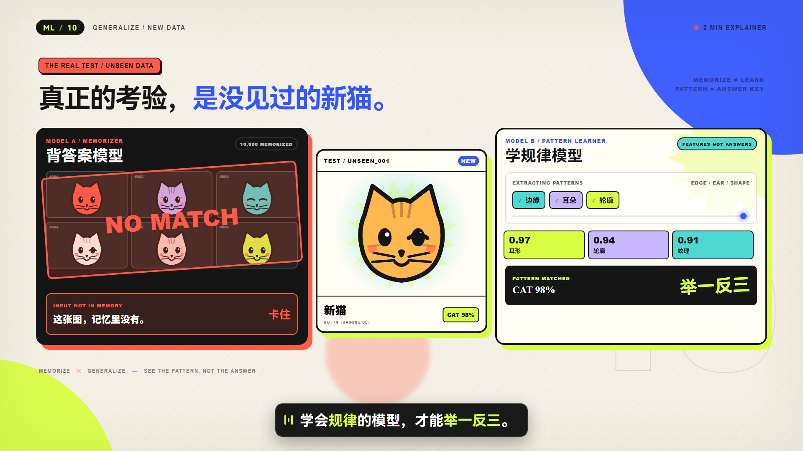

# Video Production System / 代码驱动的视频制作系统

一套以 Remotion 4、React 19、TypeScript 为核心的**完整视频生产工程**。它覆盖从脚本、TTS 旁白、逐句字幕，到视觉包装、素材管理、渲染、母带和自动质检的整条链路。

> **项目定位**
>
> 这不是机器学习（ML）项目，也不是模型训练或推理仓库。仓库里的《AI 怎么学会认猫？》和 4 分钟项目宣传片只是内置示例，用来展示这套系统如何生产视频。
>
> `ml-explainer` 是历史工程名，`MLExplainer*` 是示例片的 Composition ID，都不代表项目领域。


## 这个项目解决什么

大多数视频制作的问题不是“不会做一条”，而是“每一条都要重新来一遍”：重新找参考、重新配色、重新搭版式、重新对字幕、重新导出、重新检查响度和峰值。

这个项目把这些重复劳动收敛成一套可复用基础设施：

- **风格是参数**：色板、字号、间距、卡片、阴影、安全区都有统一 tokens。
- **动效是组件**：运镜、字效、纹理封装成 `CameraRig`、`KineticType`、`StyleTexture`。
- **时间是单一真源**：旁白、字幕、场景、BGM ducking 和音效共享同一条帧时间轴。
- **素材可管理**：本地素材管理器统一浏览成片、QC 帧、旁白、音效、字体和文档图片。
- **质量可验证**：渲染后自动检查编码、分辨率、帧数、响度、True Peak，并支持关键帧人工复核。
- **私有内容可隔离**：通用组件进入仓库，文案、配音、时间轴和成片留在本地。

## 系统组成

| 层 | 作用 | 主要位置 |
|---|---|---|
| 设计语言 | 颜色、字体、间距、圆角、描边、阴影、安全区 | `src/packaging/tokens.ts`、`src/theme.ts` |
| 视觉组件 | 纸卡、贴纸、标签、章节模板、转场、纹理 | `src/packaging/` |
| 动效系统 | 入场、弹出、线条生长、运镜、词级字效 | `src/packaging/motionPrimitives.tsx` 等 |
| 时间轴 | 旁白、字幕、BGM、SFX 共享帧时间 | `src/full/voiceTimeline.generated.ts`、`src/promo/` |
| 素材库 | 8 套色板、51 个风格配方、9 张动画语法卡 | `src/library/catalog.json` |
| 素材管理 | 搜索、筛选、预览、标签、备注、归档 | `studio/` |
| 后期与 QC | loudnorm 母带、编码/帧数/响度检查 | `scripts/master-video.mjs`、`scripts/verify-video.mjs` |

## 内置 Composition

仓库当前注册 6 个可渲染 Composition：

| ID | 时长 | 类型 | 用途 |
|---|---:|---|---|
| `MLProjectPromo` | 240 s | 项目宣传片 | 介绍系统能力、三个上游项目和使用方法 |
| `MLExplainerFull` | 120 s | 示例知识片 | 完整示例：《AI 怎么学会认猫？》 |
| `MLExplainerPreview` | 10 s | 示例知识片 | 开场钩子预览，用来先锁定审美 |
| `MLPackagingSystem` | 10 s | 视觉样张 | 颜色、卡片、贴纸、转场、音效 |
| `MLStyleLab` | 10 s | 视觉样张 | 51 个风格、8 套色板、9 张语法卡 |
| `MLExplainerBackgroundTest` | 1 s | 开发测试 | 背景组件的最小验证条目 |

示例知识片的 10 秒预览：


> `MLProjectPromo` 的逐句文案、配音和时间轴属于本地创作内容，不进入仓库。公开的是宣传片代码与版式组件；要重新渲染，需要在本地准备 `local/promo/promo-props.json`。

## 融合了三个开源项目

`src/library/catalog.json` 把三个 MIT 项目的可复用部分整理成可检索数据：

| 类别 | 数量 | 来源 |
|---|---:|---|
| 色板 | 8 | Huashu Art Motion |
| MG 风格 | 15 | MG Styles 15 |
| 花叔风格配方 | 36 | Huashu Art Motion |
| 动画语法 | 9 | Huashu Art Motion |

具体吸收了：

- **Vibe Knowledge Film**：无旁白知识片的讲解方法、字幕写法、画面语法和验收思路。
- **Huashu Art Motion**：8 套色板、36 条风格配方、9 张动画语法卡。
- **MG Styles 15**：15 种动效风格、以帧为单位的 cue 时间轴和评审维度。

总计 **51 个风格配方**。只取方法、目录和参数，不复制上游成片、GIF、音频、插画或工程文件。版权与许可见 [THIRD_PARTY_NOTICES.md](THIRD_PARTY_NOTICES.md)。

## 快速开始

要求 Node.js `^20.19` / `^22.13` / `>=24`。

```bash
npm ci
npm run dev          # 打开 Remotion Studio
npm run assets       # 打开本地素材管理器 http://127.0.0.1:4321
```

仓库包含 10 秒预览所需的 BGM、音效与示例旁白。渲染 2 分钟示例完整版前，需要先生成完整版 BGM：

```bash
npm run audio:full
```

渲染和母带输出统一写入 `local/out/`，该目录已被 `.gitignore` 忽略，不会进入仓库。

## 常用命令

```bash
npm run dev                 # Remotion Studio
npm run assets              # 本地素材管理器
npm run lint                # ESLint + TypeScript

npm run render:preview      # 渲染 10 秒示例预览
npm run master:preview      # 预览母带
npm run render:full         # 渲染 2 分钟示例完整版
npm run master:full         # loudnorm 母带
npm run verify:video        # 检查编码、分辨率、帧数、响度和峰值

npm run render:packaging    # 渲染包装系统样张
npm run master:packaging
npm run render:stylelab     # 渲染设计资产样张
npm run master:stylelab

npm run audio               # 重新生成预览 BGM 与音效
npm run audio:full          # 重新生成 120 秒示例 BGM
npm run voice               # 重新生成示例旁白与时间轴（需要 edge-tts）
npm run library:import      # 重新生成设计资产 catalog
```

## 制作流程

这套工程不是“先剪画面再配音”，而是**单一时间轴驱动**：

```text
脚本 lines.json
  → Edge TTS 逐句生成旁白
  → ffprobe 读取每句真实时长
  → 计算每段起止帧，生成时间轴
  → 场景、字幕、BGM ducking、音效读取同一套帧
  → Remotion 渲染
  → loudnorm 母带
  → verify-video 自动质检 + 人工抽帧
```

这样字幕不会和旁白错位，BGM 会在每句话出现时自动压低，段落长度也不用靠感觉猜。

完整操作步骤见 [新视频操作手册](docs/NEW_VIDEO_PLAYBOOK.md)。

## 工程结构

```text
.
├─ src/
│  ├─ Composition.tsx              Composition 注册
│  ├─ theme.ts                     基础色板与字体
│  ├─ components/                  背景、字幕、通用视觉组件
│  ├─ opening/                     10 秒示例开场
│  ├─ scenes/                      示例开场镜头
│  ├─ full/                        2 分钟示例知识片
│  │  ├─ FullVideo.tsx             总装、BGM ducking、SFX 时间点
│  │  ├─ FullCaptionBar.tsx        逐句字幕与关键词高亮
│  │  └─ voiceTimeline.generated.ts 旁白 / 字幕 / 段落时间轴
│  ├─ promo/                       4 分钟项目宣传片
│  │  ├─ PromoVideo.tsx
│  │  ├─ components.tsx
│  │  └─ scenes/                   8 个章节场景
│  ├─ packaging/                   可复用视觉包装系统
│  │  ├─ tokens.ts                 颜色、字号、间距、圆角、阴影、安全区
│  │  ├─ motion.ts                 缓动与 spring 预设
│  │  ├─ motionPrimitives.tsx      RiseIn / PopIn / DrawRule
│  │  ├─ primitives.tsx            背景、卡片、标签、贴纸、胶带
│  │  ├─ templates.tsx             ChapterOpener / EndSlate
│  │  ├─ transitions.tsx           SectionWipe / ImpactStamp / CutFlash
│  │  ├─ sound.ts                  音效库与声音规则
│  │  ├─ CameraRig.tsx             推 / 拉 / 移 / 急推六种运镜
│  │  ├─ KineticType.tsx           词级错峰入场与关键词高亮
│  │  └─ StyleTexture.tsx          纸张 / 颗粒 / 半调 / 扫描线等纹理
│  └─ library/                     设计资产索引与样张
│     ├─ catalog.json              8 套色板 / 51 个风格 / 9 张语法卡
│     ├─ index.ts                  类型、查询函数与只读导出
│     └─ StyleLab.tsx              设计资产动态样张
├─ scripts/                        旁白、BGM、母带、QC、资产导入
├─ studio/                         本地素材管理前端
├─ public/                         音频、音效、字体说明
├─ docs/                           制作规范、素材库、分镜、检查表
├─ local/                          本地产物与私有内容，已忽略
├─ package.json
├─ remotion.config.ts
└─ tsconfig.json
```

## 视觉系统



| 角色 | 色值 |
|---|---|
| 奶油纸底 | `#F4F0E5` |
| 纸张白 | `#FFFDF4` |
| 墨黑 | `#151515` |
| 荧光绿 | `#D8FF43` |
| 钴蓝 | `#3355FF` |
| 珊瑚红 | `#FF5B48` |
| 青色 | `#4ED8D2` |
| 淡紫 | `#C9B8FF` |

- 中文字体：HarmonyOS Sans SC / Noto Sans SC / Microsoft YaHei 回退链
- 英文标签：Arial Narrow 风格
- 左右安全区 86px，底部字幕安全区 34px
- 同一画面不超过 3 个主色，同屏最多两个运动焦点
- 所有动画由 `frame` / `spring` / `interpolate` 驱动，不依赖真实时间

风格不是贴纸。`CameraRig`、`KineticType`、`StyleTexture` 把运镜、字效和纹理变成可传参组件；所有 Remotion 实现都是本项目原创代码。详见 [参考库与设计资产](docs/REFERENCE_LIBRARY.md)。

## 可以复用 / 需要重做

复用这一层基础设施：

- 色板、字号、间距、圆角、描边、阴影、安全区
- 纸张背景、纸卡、标签、贴纸、胶带、分隔线
- 入场、弹出、漂浮、线条生长
- 章节开场、结尾卡、色块擦除、冲击印章
- 音效库、BGM ducking 规则
- 渲染、母带、QC 脚本与素材管理器

每条新视频仍然要重新做：

- 选题、脚本、旁白
- 主题图形与场景编排
- 字幕断句与时间轴
- 封面与 BGM 编排

## 文档

- [新视频操作手册](docs/NEW_VIDEO_PLAYBOOK.md)：从脚本到交付的完整流程
- [视觉包装系统](docs/VISUAL_PACKAGING_SYSTEM.md)：设计语言、组件和命名规范
- [素材库清单](docs/ASSET_LIBRARY.md)：已封装的视觉、动效和声音资产
- [素材管理器](docs/ASSET_MANAGER.md)：本地素材库的界面、元数据与归档
- [参考库与设计资产](docs/REFERENCE_LIBRARY.md)：三个上游项目的取用边界
- [生产检查表](docs/PRODUCTION_CHECKLIST.md)：脚本、分镜、版式、声音、QC
- [示例片分镜](docs/STORYBOARD.md)：《AI 怎么学会认猫？》的分镜案例

## 素材与许可

- 代码以 [MIT](LICENSE) 发布。
- 示例旁白由 Edge TTS 生成，音色为 `zh-CN-XiaoxiaoNeural`。
- BGM 与 SFX 由仓库内脚本程序化合成，不含第三方采样。
- 字体不随仓库分发，运行时回退到系统已安装字体。
- 仓库不包含最终成片；预览 GIF、封面和 UI 截图仅用于项目说明。
- 设计资产目录改编自三个 MIT 项目，版权与许可见 [THIRD_PARTY_NOTICES.md](THIRD_PARTY_NOTICES.md)。

## English

A code-driven **video production system** built with Remotion 4, React 19 and TypeScript. It covers script-driven voiceover, frame-accurate captions, reusable editorial motion design, local asset management, rendering, loudness mastering and automated QC.

The machine-learning explainer included in this repository is a **sample film**, not the project's subject. The repository is about producing videos as a reproducible engineering workflow.

It also includes a local asset manager (`npm run assets`) and a design catalog distilled from three MIT-licensed projects: 8 palettes, 51 style recipes and 9 animation grammars. No upstream media or renderer code is redistributed.

```bash
npm ci
npm run dev
npm run assets
npm run render:full && npm run master:full && npm run verify:video
```

Licensed under MIT.
