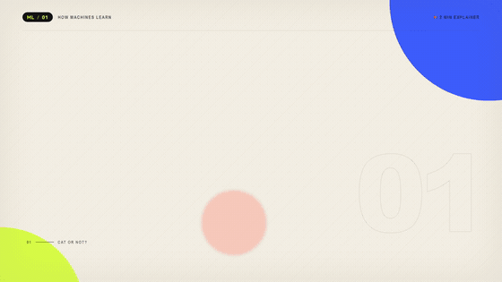

# ML Explainer / 机器学习科普视频

一条 2 分钟的机器学习科普短片，以及一套可以复用到下一条视频的**编辑设计动效系统**。

全部画面由 React + Remotion 以代码生成：没有剪辑软件工程文件，没有逐帧手 K，改文案、改配色、改节奏都落在代码里。



> 上方为 10 秒预览（GIF，1.9 MB）。完整 2 分钟成片与封面在本地 `local/out/` 生成，不进入仓库。

## 三条 Composition

| ID | 时长 | 用途 |
|---|---|---|
| `MLExplainerFull` | 120 s | 完整科普片：AI 如何从例子中学会认猫 |
| `MLExplainerPreview` | 10 s | 开头钩子预览，用来先锁定审美 |
| `MLPackagingSystem` | 10 s | 包装系统样张：颜色、卡片、贴纸、转场、音效 |

验收规格：

| 项目 | 标准 |
|---|---|
| 画幅 | 1920 × 1080，16:9 |
| 帧率 | 30 fps |
| 视频 | H.264，yuv420p，CRF 18 |
| 音频 | AAC 48 kHz stereo，192 kbps |
| 响度 | -15.5 ~ -16 LUFS |
| True Peak | ≤ -1.0 dBTP |
| 字幕 | 逐句烧录，关键词高亮，两行安全排版 |

## 快速开始

要求 Node.js `^20.19` / `^22.13` / `>=24`。

```bash
npm ci
npm run dev          # 打开 Remotion Studio
```

仓库已包含 10 秒预览所需的 BGM 与音效，克隆后可以直接预览和渲染。

完整版 BGM（约 20 MB）是生成物，不进入仓库，首次渲染完整版前执行：

```bash
npm run audio:full
```

## 常用命令

```bash
npm run dev                 # Remotion Studio
npm run lint                # ESLint + TypeScript
npm run render:preview      # 渲染 10 秒预览
npm run master:preview      # 预览母带
npm run render:full         # 渲染 2 分钟完整版
npm run master:full         # loudnorm 母带
npm run render:packaging    # 渲染包装系统样张
npm run master:packaging    # 样张母带
npm run verify:video        # 检查编码、分辨率、帧数、响度、峰值
npm run verify:packaging    # 检查样张
npm run audio               # 重新生成预览 BGM 与音效
npm run audio:full          # 重新生成 120 秒 BGM
npm run voice               # 重新生成旁白与时间轴（需要 edge-tts）
```

渲染输出统一写入 `local/out/`。这个目录已被 `.gitignore` 忽略，成片、封面、QC 抽帧都留在本地。

## 工程结构

```text
.
├─ src/
│  ├─ Composition.tsx              Composition 注册与预览音频混音
│  ├─ Root.tsx
│  ├─ theme.ts                     基础色板与字体
│  ├─ components/Design.tsx        背景、字幕、角色等通用组件
│  ├─ opening/                     10 秒开场
│  ├─ scenes/                      开场四个镜头
│  ├─ full/                        2 分钟完整版
│  │  ├─ FullVideo.tsx             总装、BGM ducking、SFX 时间点
│  │  ├─ FullCaptionBar.tsx        逐句字幕与关键词高亮
│  │  ├─ voiceTimeline.generated.ts 旁白 / 字幕 / 段落时间轴
│  │  ├─ components/NetworkGraph.tsx
│  │  └─ scenes/                   8 个段落场景
│  └─ packaging/                   可复用视觉包装系统
│     ├─ tokens.ts                 颜色、字号、间距、圆角、阴影、安全区
│     ├─ motion.ts                 缓动与 spring 预设
│     ├─ motionPrimitives.tsx      RiseIn / PopIn / DrawRule
│     ├─ primitives.tsx            背景、卡片、标签、贴纸、胶带
│     ├─ templates.tsx             ChapterOpener / EndSlate
│     ├─ transitions.tsx           SectionWipe / ImpactStamp / CutFlash
│     ├─ sound.ts                  音效库与声音规则
│     └─ PackagingShowcase.tsx     包装系统样张
├─ scripts/
│  ├─ lib/binaries.mjs             跨平台定位 ffmpeg / ffprobe
│  ├─ generate-audio.mjs           程序化生成预览 BGM 与 SFX
│  ├─ generate-full-bgm.mjs        生成 120 秒 BGM
│  ├─ generate-full-voiceover.mjs  Edge TTS 旁白 + 时间轴
│  ├─ master-video.mjs             loudnorm 母带
│  └─ verify-video.mjs             成片 QC
├─ public/
│  ├─ audio/                       旁白、预览 BGM
│  ├─ sfx/                         转场与点击音效
│  └─ fonts/                       字体放置说明（不附带字体文件）
├─ docs/                           制作规范、素材库、分镜、检查表
├─ local/                          本地产物，已忽略（不会上传）
├─ package.json
├─ remotion.config.ts
└─ tsconfig.json
```

## 制作流程

这套工程不是“先剪画面再配音”，而是**单一时间轴驱动**：

```text
full-lines.json
  → Edge TTS 逐句生成旁白
  → ffprobe 读取每句真实时长
  → 计算每段起止帧，生成 voiceTimeline.generated.ts
  → 场景、字幕、BGM ducking、音效全部读取同一条时间轴
  → Remotion 渲染
  → loudnorm 母带
  → verify-video 自动质检 + 人工抽帧
```

这样字幕不会和旁白错位，BGM 会在每句话出现时自动压低，段落长度也不会靠感觉猜。

细节见 [新视频操作手册](docs/NEW_VIDEO_PLAYBOOK.md)。

## 视觉系统


| 角色 | 色值 |
|---|---|
| 奶油纸底 | `#F4F0E5` |
| 纸张白 | `#FFFDF4` |
| 墨黑 | `#151515` |
| 荧光绿 | `#D8FF43` |
| 钴蓝 | `#3355FF` |
| 珊瑚红 | `#FF5B48` |
| 青色 | `#4ED8D2` |
| 淡紫 | `#C9B8FF` |

- 中文字体：HarmonyOS Sans SC / Noto Sans SC / Microsoft YaHei 回退链
- 英文标签：Arial Narrow 风格
- 左右安全区 86px，底部字幕安全区 34px
- 同一画面不超过 3 个主色，同屏最多两个运动焦点
- 所有动画由 `frame` / `spring` / `interpolate` 驱动，不依赖真实时间

规范文档：

- [视觉包装系统](docs/VISUAL_PACKAGING_SYSTEM.md)
- [素材库清单](docs/ASSET_LIBRARY.md)
- [生产检查表](docs/PRODUCTION_CHECKLIST.md)
- [新视频操作手册](docs/NEW_VIDEO_PLAYBOOK.md)
- [2 分钟分镜](docs/STORYBOARD.md)

## 可以复用 / 需要重做

复用这一层基础设施：

- 色板、字号、间距、圆角、描边、阴影、安全区
- 纸张背景、纸卡、标签、贴纸、胶带、分隔线
- 入场、弹出、漂浮、线条生长
- 章节开场、结尾卡、色块擦除、冲击印章
- 音效库、BGM ducking 规则
- 渲染、母带、QC 脚本

每条新视频仍然要重新做：

- 选题、脚本、旁白
- 主题图形与场景编排
- 字幕断句与时间轴
- 封面与 BGM 编排（可沿用音色，不要整条复用）

## 素材与许可

- 代码以 [MIT](LICENSE) 发布。
- 旁白由 Edge TTS 生成，音色为 `zh-CN-XiaoxiaoNeural`。
- BGM 与 SFX 由仓库内脚本程序化合成，不含第三方采样。
- 字体不随仓库分发。运行时会依次回退到系统已安装的 HarmonyOS Sans SC、Noto Sans SC、Microsoft YaHei。
- 仓库不包含最终成片。预览 GIF 与封面除外，均可自由用于项目说明。

## English

A 2-minute machine-learning explainer built entirely in code with Remotion 4, React 19 and TypeScript. It ships with a reusable editorial motion-graphics system: tokens, paper-card primitives, motion presets, transitions, a sound library, a single voiceover timeline that drives captions and BGM ducking, plus mastering and QC scripts.

```bash
npm ci
npm run dev
npm run render:full && npm run master:full && npm run verify:video
```

Renders go to `local/out/` (git-ignored). Run `npm run audio:full` once before rendering the full video, because the 120-second BGM is generated rather than committed.

Licensed under MIT.