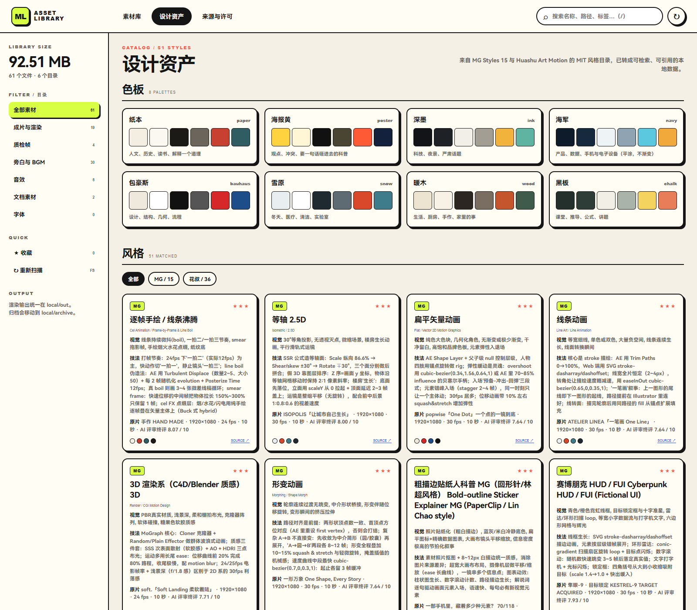

# 代码驱动的视频制作系统

一套基于 **Remotion 4、React 19、TypeScript** 的完整视频生产工程。它把脚本时间轴、旁白与字幕、视觉包装、素材管理、渲染、母带和自动质检收敛成一条可复用的工程链路。

> 这是一个通用视频框架仓库，不包含具体视频项目的文案、配音、分镜或成片。
> 示例片相关源码和素材已归档到本地 `local/examples/`，不会进入 Git。



## 解决什么问题

大多数视频制作的问题不是“不会做一条”，而是“每一条都要重新来一遍”：重新找参考、重新配色、重新搭版式、重新对字幕、重新导出、重新检查响度和峰值。

这个项目把这些重复劳动收敛成一套可复用基础设施：

- **风格是参数**：色板、字号、间距、卡片、阴影、安全区都有统一 tokens。
- **动效是组件**：运镜、字效、纹理封装成 `CameraRig`、`KineticType`、`StyleTexture`。
- **时间是单一真源**：旁白、字幕、场景、BGM ducking 和音效共享同一条帧时间轴。
- **素材可管理**：本地素材管理器统一浏览成片、QC 帧、旁白、音效、字体和文档图片。
- **质量可验证**：渲染后自动检查编码、分辨率、帧数、响度、True Peak，并支持关键帧人工复核。
- **私有内容可隔离**：通用组件进入仓库，文案、配音、时间轴和成片留在本地。

## 系统组成

| 层 | 作用 | 主要位置 |
|---|---|---|
| 设计语言 | 颜色、字体、间距、圆角、描边、阴影、安全区 | `src/packaging/tokens.ts`、`src/theme.ts` |
| 视觉组件 | 纸卡、贴纸、标签、章节模板、转场、纹理 | `src/packaging/` |
| 动效系统 | 入场、弹出、线条生长、运镜、词级字幕 | `src/packaging/motionPrimitives.tsx` 等 |
| 素材库 | 8 套色板、51 个风格配方、9 张动画语法卡 | `src/library/catalog.json` |
| 默认旁白 | 晓晓 +15% 音色、示例音频与通用生成脚本 | `src/audio/voiceProfiles.json`、`scripts/generate-voiceover.mjs` |
| 素材管理 | 搜索、筛选、预览、标签、备注、归档 | `studio/` |
| 后期与 QC | loudnorm 母带、编码/帧数/响度检查 | `scripts/master-video.mjs`、`scripts/verify-video.mjs` |

## 内置 Composition

仓库只保留通用视觉样张，不注册任何具体视频项目：

| ID | 时长 | 用途 |
|---|---:|---|
| `PackagingSystem` | 10 s | 展示颜色、卡片、贴纸、转场和音效系统 |
| `StyleLab` | 10 s | 展示 51 个风格、8 套色板、9 张语法卡 |
| `BackgroundTest` | 1 s | 背景组件的最小开发测试 |


## 快速开始

要求 Node.js `^20.19` / `^22.13` / `>=24`。

```bash
npm ci
npm run dev          # 打开 Remotion Studio
npm run assets       # 打开本地素材管理器 http://127.0.0.1:4321
```

渲染和母带输出统一写入 `local/out/`。该目录已被 `.gitignore` 忽略，不会进入仓库。

## 常用命令

```bash
npm run dev                 # Remotion Studio
npm run assets              # 本地素材管理器
npm run lint                # ESLint + TypeScript

npm run render:packaging    # 渲染包装系统样张
npm run master:packaging    # loudnorm 母带
npm run verify:packaging    # 检查编码、分辨率、帧数、响度和峰值
npm run pipeline:packaging  # 渲染 → 母带 → 质检，一条命令跑完

npm run render:stylelab     # 渲染设计资产样张
npm run master:stylelab
npm run pipeline:stylelab    # 渲染 → 母带 → 质检

npm run audio               # 重新生成通用音效与预览 BGM
npm run voice -- --manifest local/projects/my-video/lines.json  # 用默认音色生成旁白与时间轴
npm run library:import      # 重新生成设计资产 catalog
```

## 制作流程

这套工程不是“先剪画面再配音”，而是**单一时间轴驱动**：

```text
脚本 lines.json
  → 旁白音频（TTS 或录音）逐句生成
  → ffprobe 读取每句真实时长
  → 计算每段起止帧，生成时间轴
  → 场景、字幕、BGM ducking、音效读取同一套帧
  → Remotion 渲染
  → loudnorm 母带
  → verify-video 自动质检 + 人工抽帧
```

这样字幕不会和旁白错位，BGM 会在每句话出现时自动压低，段落长度也不用靠感觉猜。

## 目录结构

```text
.
├─ src/
│  ├─ Composition.tsx             通用 Composition 注册
│  ├─ theme.ts                     基础色板与字体
│  ├─ audio/                       默认旁白音色配置
│  ├─ components/                  背景、字幕、通用视觉组件
│  ├─ packaging/                   可复用视觉包装系统
│  │  ├─ tokens.ts                 颜色、字号、间距、圆角、阴影、安全区
│  │  ├─ motion.ts                 缓动与 spring 预设
│  │  ├─ motionPrimitives.tsx      RiseIn / PopIn / DrawRule
│  │  ├─ primitives.tsx            背景、卡片、标签、贴纸、胶带
│  │  ├─ templates.tsx             ChapterOpener / EndSlate
│  │  ├─ transitions.tsx           SectionWipe / ImpactStamp / CutFlash
│  │  ├─ sound.ts                  音效库与声音规则
│  │  ├─ CameraRig.tsx             推 / 拉 / 摇 / 急推六种运镜
│  │  ├─ KineticType.tsx           词级错峰入场与关键词高亮
│  │  └─ StyleTexture.tsx          纸张 / 颗粒 / 半调 / 扫描线等纹理
│  └─ library/                     设计资产索引与样张
│     ├─ catalog.json              8 套色板 / 51 个风格 / 9 张语法卡
│     ├─ index.ts                  类型、查询函数与只读导出
│     └─ StyleLab.tsx              设计资产动态样张
├─ scripts/                        母带、QC、资产导入与通用音频生成
├─ studio/                         本地素材管理前端
├─ public/                         通用音频、音效、字体说明
├─ docs/                           制作规范、素材库、检查表
├─ local/                          本地产物、私有内容与归档示例，已忽略
├─ package.json
├─ remotion.config.ts
└─ tsconfig.json
```

## 素材库

`src/library/catalog.json` 把三个 MIT 项目的可复用部分整理成可检索数据：

| 类别 | 数量 | 来源 |
|---|---:|---|
| 色板 | 8 | Huashu Art Motion |
| MG 风格 | 15 | MG Styles 15 |
| 花叔风格配方 | 36 | Huashu Art Motion |
| 动画语法 | 9 | Huashu Art Motion |

只取方法、目录和参数，不复制上游成片、GIF、音频、插画或工程文件。版权与许可见 [THIRD_PARTY_NOTICES.md](THIRD_PARTY_NOTICES.md)。

## 私有内容与示例片

- 具体项目的文案、配音、时间轴、分镜和成片放在 `local/`。
- `local/examples/` 保存已归档的示例片源码、素材和生成脚本，不在 Git 中。
- 新建视频时，建议在 `local/projects/<project-name>/` 下组织私有内容，再把通用组件和 Composition 注册到 `src/`。
- 项目旁白输出到 `public/projects/<project-name>/`，该目录已被忽略；默认音色示例见 [旁白与语音指南](docs/VOICE_GUIDE.md)。
- 不要提交 `local/`、`out/`、`dist/` 或任何带具体文案的渲染产物。

## 渲染、母带与质检

这三步是固定顺序，后一步依赖前一步的产物：

```text
Remotion render
  → scripts/master-video.mjs
  → scripts/verify-video.mjs
```

| 步骤 | 作用 | 产物 |
|---|---|---|
| 渲染 | 逐帧执行 React 组件，编码 H.264 + AAC | `local/out/*.mp4` |
| 母带 | 两遍 `loudnorm`，把响度拉到约 -16 LUFS，视频流直接复制 | `local/out/*-final.mp4` |
| 质检 | 检查编码、分辨率、帧数、音频参数、响度和 True Peak | 终端 PASS/FAIL 报告 |

渲染输出的是**完整视频**，不是单帧。需要单帧检查时用 `remotion still`。

### 分步执行

```bash
npm run render:packaging
npm run master:packaging
npm run verify:packaging
```

每一步结束后再执行下一步。适合调画面、改字幕、只重渲某一段的时候使用。

### 一条命令跑完

```bash
npm run pipeline:packaging
```

等价于依次执行：

```text
render:packaging → master:packaging → verify:packaging
```

脚本使用 `&&` 串行执行：前一步失败，后续步骤不会继续；质检不通过时命令会以非零状态退出。

`StyleLab` 也有同样的流程：

```bash
npm run pipeline:stylelab
```

### 耗时参考

以下是本机 10 秒 `PackagingSystem` 样张的实测值，环境为 1920×1080、30fps、8x 并发：

| 阶段 | 10 秒样张实测 | 2 分钟估算 | 4 分钟估算 |
|---|---:|---:|---:|
| 渲染 | 12.6 秒 | 2–5 分钟 | 4–10 分钟 |
| 母带 | 1.1 秒 | 10–20 秒 | 20–40 秒 |
| 质检 | 1.3 秒 | 15–30 秒 | 30–60 秒 |
| 合计 | 约 15 秒 | 2.5–6 分钟 | 5–12 分钟 |

这些是参考值，不是固定承诺。画面越复杂、图片和视频素材越多、并发越低，渲染越慢；母带只处理音频，所以通常很快；质检需要完整解码视频数帧，长视频会明显变慢。

第一次渲染还要额外花约 5–6 秒做 bundle。低清草稿（`--scale=0.5`）不能直接用于最终质检，因为 `verify-video.mjs` 固定检查 1920×1080 和 30fps。

更完整的制作规范见 [新视频操作手册](docs/NEW_VIDEO_PLAYBOOK.md) 和 [生产检查表](docs/PRODUCTION_CHECKLIST.md)。

## 许可

本仓库代码遵循仓库中的许可证文件。第三方方法、目录和参数的来源与许可见 [THIRD_PARTY_NOTICES.md](THIRD_PARTY_NOTICES.md)。
