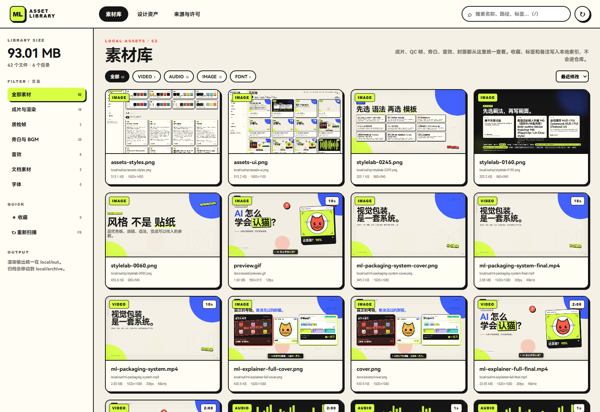
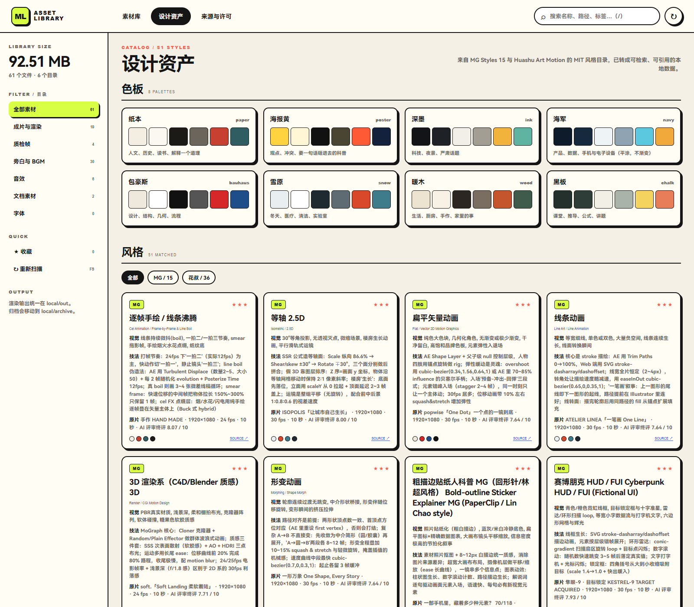

# 素材管理器

`npm run assets` 会启动一个零依赖的本地素材管理器：

```text
http://127.0.0.1:4321
```

它把渲染成片、QC 抽帧、旁白、BGM、音效、文档素材和字体放在同一个界面里，不替代 Remotion Studio，也不参与渲染，只负责**找得到、看得清、标得准、归档得掉**。



## 启动

要求 Node.js `^20.19` / `^22.13` / `>=24`，以及仓库已有的 `ffmpeg` / `ffprobe`。

```bash
npm run assets
```

默认只监听 `127.0.0.1`，不会被局域网里的其他机器访问。

换端口：

```powershell
$env:ASSET_PORT=4322
npm run assets
```

```bash
ASSET_PORT=4322 npm run assets
```

确实需要在局域网里访问时，才显式放开：

```powershell
$env:ASSET_HOST="0.0.0.0"
npm run assets
```

这个服务没有登录和权限系统。除非前面有带认证的反向代理，否则不要把它直接暴露到公网。

## 界面

顶部三个页签：

| 页签 | 内容 |
|---|---|
| 素材库 | 本地文件、缩略图、类型/目录筛选、搜索、排序、详情抽屉 |
| 设计资产 | 8 套色板、15 种 MG 风格、36 条花叔配方、9 张语法卡 |
| 来源与许可 | 三条上游项目的用途、边界和 MIT 声明 |

素材库的常用操作：

- `/` 聚焦搜索框；搜索名称、路径、标签、目录。
- 按 `视频 / 音频 / 图片 / 字体` 过滤，或按左侧目录过滤。
- 按最近修改、文件大小、名称、时长排序。
- 点卡片打开详情抽屉：视频/音频可直接预览，图片显示原图。
- 详情里可以收藏、写标签、写备注、复制路径、复制 `staticFile()` 片段、在资源管理器里定位、归档。

快捷键 `Esc` 关闭详情抽屉。



## 目录分组

分组写死在 `studio/server.mjs` 的 `GROUPS` 数组里：

| 分组 | 路径 | 递归 | 说明 |
|---|---|---:|---|
| 成片与渲染 | `local/out/` | 否 | 成片、母带、封面、包装样张 |
| 质检帧 | `local/out/qc/` | 是 | 抽帧、拼图、UI 截图 |
| 旁白与 BGM | `public/audio/` | 是 | 默认旁白示例与预览 BGM 可提交；项目旁白放 `public/projects/` 并忽略 |
| 音效 | `public/sfx/` | 是 | 转场、点击、冲击音效 |
| 文档素材 | `docs/assets/` | 否 | README 和文档引用的图片 |
| 字体 | `public/fonts/` | 否 | 字体放置说明或本地字体 |

新增目录时改 `GROUPS`，同时确认它是否应该出现在 `ALLOWED` 里。`ALLOWED` 决定服务能读取哪些路径，`WRITABLE` 决定哪些路径允许归档。

## 元数据

收藏、标签和备注写入：

```text
local/.cache/asset-meta.json
```

格式：

```json
{
  "local/out/video-project-final.mp4": {
    "favorite": true,
    "tags": ["成片", "待审"],
    "note": "这版语速合适，保留。"
  }
}
```

这个文件在 `local/` 下，已经被 `.gitignore` 忽略。换机器或重新克隆后不会带走收藏和备注，这是有意的：仓库只保留可复现的代码和素材，不把个人工作状态上传。

## 归档

详情抽屉里的“归档”只对 `local/` 下的文件生效。

归档不是删除，而是移动：

```text
local/out/video-project.mp4
  → local/archive/2026-11-19T14-03-22/video-project.mp4
```

时间戳目录保留原相对路径，避免不同版本的 `cover.png` 互相覆盖。需要恢复时，把文件移回原目录即可。

## 缩略图与探测

- 视频和 GIF 用 `ffmpeg` 抽取约 12% 处的一帧，缓存到 `local/.cache/thumbs/`。
- 图片直接走原图。
- `ffprobe` 读取时长、分辨率、帧率、视频编码、音频编码、采样率和声道数，结果缓存到 `local/.cache/assets-index.json`。
- 缓存键包含路径、修改时间和文件大小。文件变了会自动重新探测。

## API

服务是单文件 Node HTTP，没有 Express，也没有构建步骤。

| 方法 | 路径 | 作用 |
|---|---|---|
| GET | `/api/bootstrap` | 返回素材、分组统计、设计资产 catalog、仓库根路径 |
| POST | `/api/meta` | 写入收藏、标签、备注 |
| POST | `/api/archive` | 把 `local/` 下的文件移动到 `local/archive/` |
| POST | `/api/reveal` | 在系统文件管理器中定位文件 |
| GET | `/media?path=...` | 支持 Range 的文件流 |
| GET | `/thumb?path=...` | 视频/GIF 缩略图 |

所有文件路径都经过 `safeResolve`：

- 拒绝空路径、空字节和 `..`。
- 只允许读取 `GROUPS`、`local/archive/` 和 `public/fonts/` 内的路径。
- 静态前端只允许读 `studio/public/`。

## 文件结构

```text
studio/
├─ server.mjs          # HTTP 服务、扫描、探测、缩略图、归档
└─ public/
   ├─ index.html       # 三页签骨架
   ├─ app.js           # 数据加载、筛选、抽屉、元数据写入
   └─ style.css        # 奶油纸底 + 荧光绿的编辑设计
```

## 一条新视频的工作流

1. 使用自己的渲染命令，或运行 `npm run render:packaging`，产物进 `local/out/`。
2. `npm run assets`，在素材库里给这一版打标签，例如 `待审 / 已发布 / 废片`。
3. 需要引用到文档或页面时，复制 `staticFile()` 片段；只对 `public/` 下的文件生成。
4. 旧版本点“归档”，移动到 `local/archive/`，不占素材库主视图。
5. 交付前用“质检帧”分组复查字幕、安全区和关键静帧。

## 已知边界

- 不做上传、转码、剪辑、删除。转码和母带仍然走 `scripts/`。
- 不做用户系统、多人协作和远程存储。
- 元数据是本地单机文件，不是数据库。
- 扫描是启动时和点刷新时进行，不监听文件系统变化。
- 设计资产页只展示派生索引；要重新生成，先准备 `local/reference/`，再跑 `npm run library:import`。

